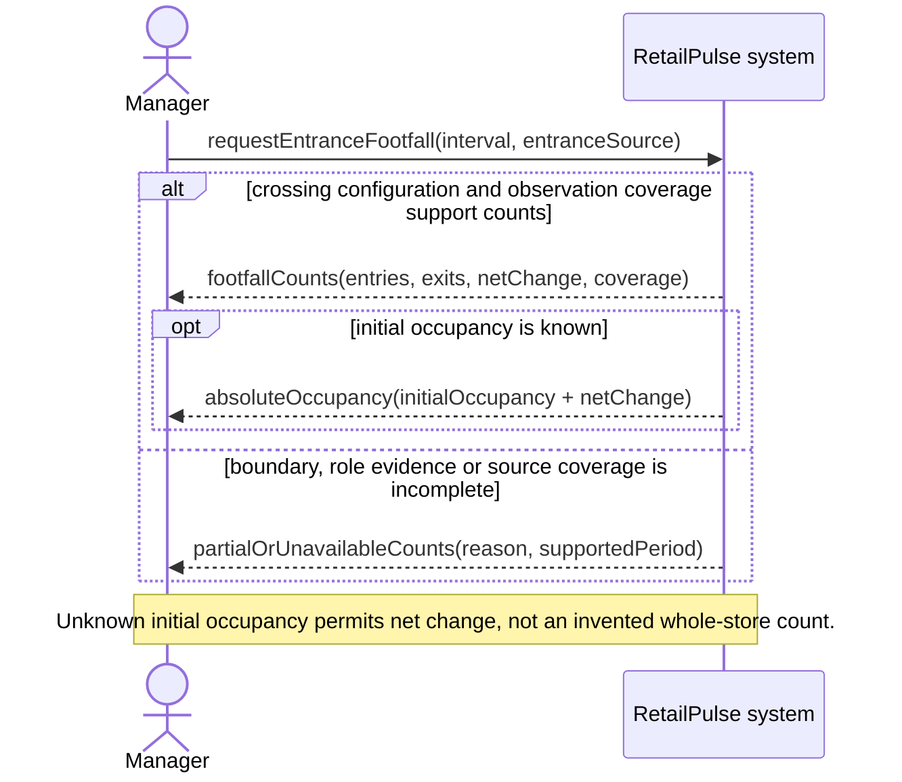
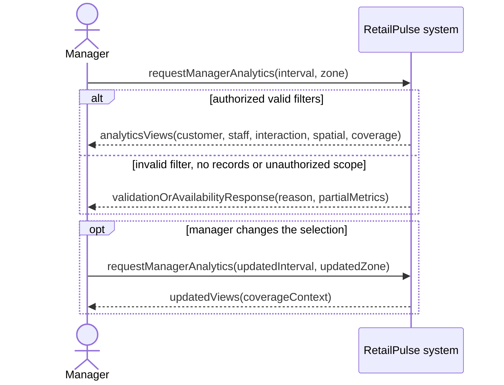
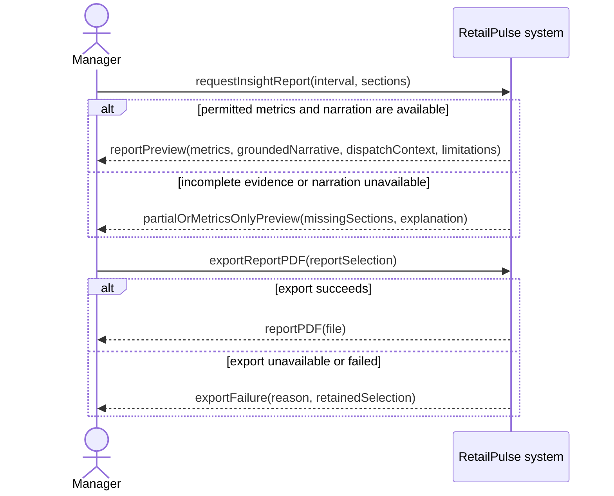
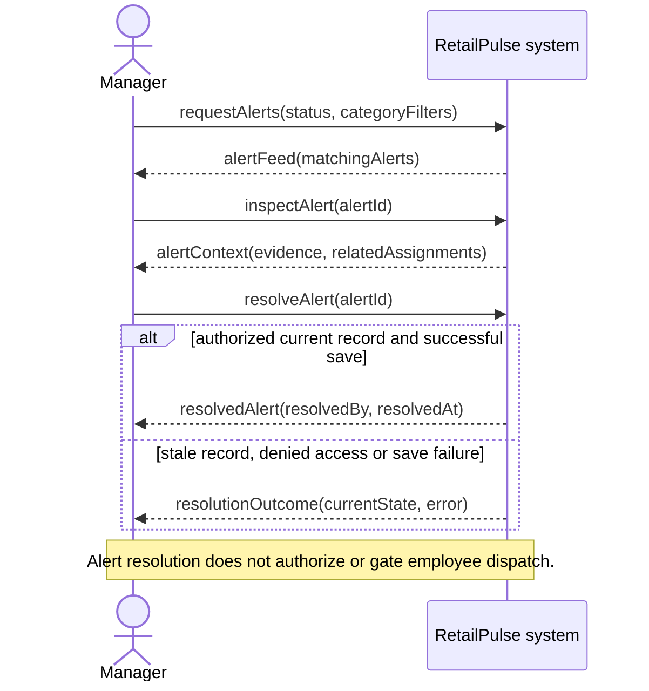
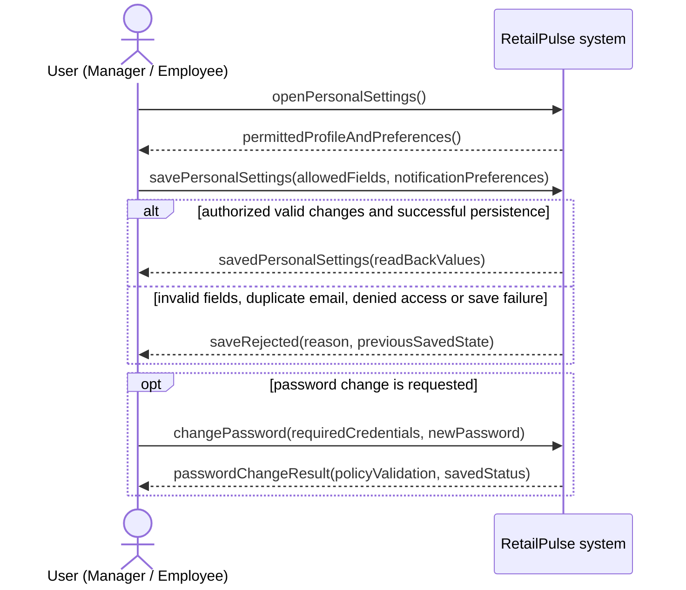
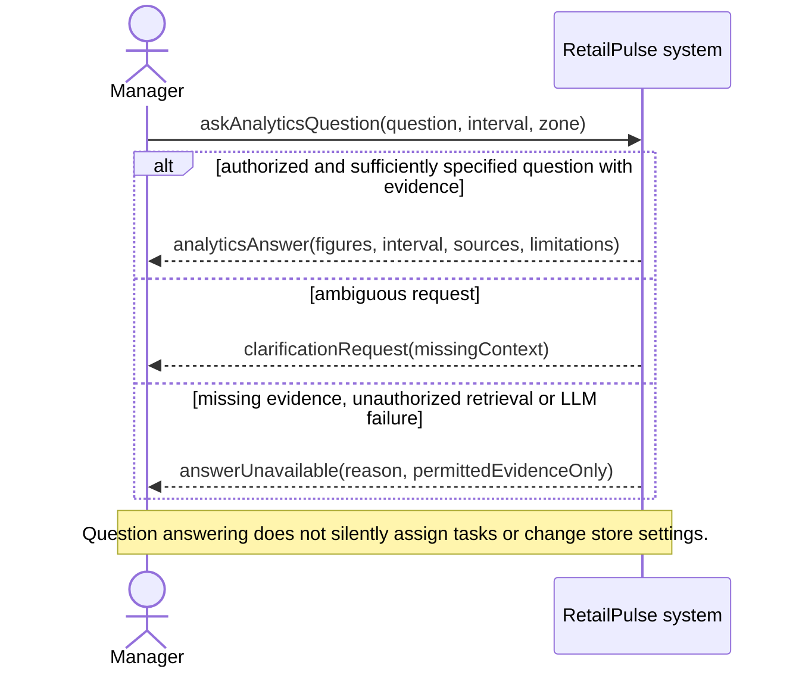

# RetailPulse system sequence diagrams

Exactly 17 SSDs correspond to the 17 current FR/UC pairs. These are black-box target interactions, not implementation-completion claims. The report includes the TikZ versions under System Sequence Diagrams in Chapter 5 (System Design); individual `.mmd` files are editable Mermaid sources.

Requests and the initial assignment notification use solid arrows; responses use dashed arrows. Internal agents and databases are inside the system boundary. UC-36 starts with a supported operational need and direct system-to-employee instruction, without manager approval. Operation names are conceptual, not literal API endpoints.

## UC-01: Analyze a video

Primary FR: **FR-01**. Status: Implemented CLI; recorded subset.

```mermaid
sequenceDiagram
    actor A as Operator / project team
    participant S as RetailPulse system
    A->>S: analyzeVideo(video, configuration, outputLocation)
    alt input and required models are valid
    S-->>A: processingAccepted(runId, samplingConfiguration)
    S-->>A: analysisCompleted(runId, coverage, diagnosticOutputLocations)
    else invalid input, missing model or interrupted processing
    S-->>A: analysisFailed(reason, partialOutputStatus)
    end
    Note over A,S: A processed sample with no people is a valid empty observation; it is distinct from a failed frame.
```

## UC-02: Obtain entrance footfall

Primary FR: **FR-02**. Status: Target; count evaluation not established.



## UC-04: Analyze customer service interactions

Primary FR: **FR-04**. Status: Implemented candidate logic; service metrics partial.

```mermaid
sequenceDiagram
    actor A as Manager
    participant S as RetailPulse system
    A->>S: requestServiceAnalysis(interval, zone)
    alt supported role and track observations are available
    S-->>A: serviceEvidence(interactions, durations, verdicts, coverage)
    opt entry history and store policy support further timing
    S-->>A: serviceTiming(approachTimes, potentiallyUnattendedEvents)
    end
    else unknown roles, occlusion or missing history
    S-->>A: partialServiceEvidence(unsupportedMetrics, reasons)
    end
    Note over A,S: Judge off, unavailable or failing retains an unverified proximity fallback; possible service is not verified assistance.
```

## UC-07: Analyze spatial customer activity

Primary FR: **FR-07**. Status: Target; demo UI.

```mermaid
sequenceDiagram
    actor A as Manager
    participant S as RetailPulse system
    A->>S: requestSpatialActivity(interval, zone)
    alt valid zones and adequate observation coverage
    S-->>A: spatialActivity(paths, dwell, occupancyMap, hotGrayZones, coverage)
    else invalid zone or inadequate coverage
    S-->>A: unavailableSpatialFindings(reason, supportedScope)
    end
    Note over A,S: Unsupported cross-camera identity cannot produce a whole-store path; absent coverage is not low activity.
```

## UC-10: Access a role-specific account

Primary FR: **FR-10**. Status: Implemented mechanisms; subset tested.

```mermaid
sequenceDiagram
    actor A as User (Manager / Employee)
    participant S as RetailPulse system
    opt account activation is needed
    A->>S: activateAccount(invitationToken, permittedRegistrationDetails)
    S-->>A: activationResult(accountStatus, validationErrors)
    end
    A->>S: login(credentials, requestedRole)
    alt credentials, active account and assigned role are valid
    S-->>A: authenticatedSession(permittedWorkspace)
    A->>S: logout()
    S-->>A: sessionEnded()
    else invalid credentials, role mismatch or expired access
    S-->>A: accessDenied(reason)
    end
    Note over A,S: Activation/login errors create no authorized session; a selected role cannot elevate the account.
```

## UC-11: Monitor camera observations

Primary FR: **FR-11**. Status: Partial; recording/snapshot UI.

```mermaid
sequenceDiagram
    actor A as Manager
    participant S as RetailPulse system
    A->>S: openCameraMonitoring()
    S-->>A: configuredSources(availability)
    A->>S: selectCamera(sourceId)
    alt source and analytical observations are available
    S-->>A: cameraView(availableOverlays, observedAt, processedAt)
    else offline source, stale output or missing overlays
    S-->>A: cameraAvailability(state, lastObservation, overlayLimitations)
    end
    Note over A,S: Observation freshness is explicit; the target view does not imply guaranteed real-time processing.
```

## UC-12: Review manager analytics

Primary FR: **FR-12**. Status: Partial; demo/snapshot metrics.



## UC-13: Review personal workspace

Primary FR: **FR-13**. Status: Partial; own tasks plus demo history.

```mermaid
sequenceDiagram
    actor A as Employee
    participant S as RetailPulse system
    A->>S: openPersonalWorkspace()
    alt authenticated account and permitted own-record scope
    S-->>A: ownWorkspace(shift, assignedZone, currentTasks, updates)
    A->>S: requestOwnActivityHistory(interval)
    S-->>A: ownActivityHistory(records, coverageOrEmptyState)
    else expired session or another employee requested
    S-->>A: accessDeniedOrLoginRequired()
    end
    Note over A,S: Task status changes belong to UC-36; no composite employee score is required.
```

## UC-17: Generate an insight report

Primary FR: **FR-17**. Status: Target; route unavailable.



## UC-18: Manage operational alerts

Primary FR: **FR-18**. Status: Implemented API/UI; scenarios unverified.



## UC-19: Inspect system status

Primary FR: **FR-19**. Status: Partial; hard-coded status.

```mermaid
sequenceDiagram
    actor A as Manager
    participant S as RetailPulse system
    A->>S: requestSystemStatus()
    S-->>A: componentStatus(health, availableThroughput, activity, timestamps)
    A->>S: inspectComponent(componentId)
    alt measured telemetry is available
    S-->>A: componentDetails(measures, recordedAt)
    else telemetry missing, stale, inactive or failed
    S-->>A: explicitStatus(state, unavailableMeasures, reason)
    end
    Note over A,S: The seven agreed target components are distinguished from shared tools; hard-coded/demo values are labelled.
```

## UC-20: Manage personal settings

Primary FR: **FR-20**. Status: UI/proposed persistence.



## UC-29: Configure store operations

Primary FR: **FR-29**. Status: Partial; stored config, incomplete consumers.

```mermaid
sequenceDiagram
    actor A as Manager
    participant S as RetailPulse system
    A->>S: requestStoreSettings()
    S-->>A: currentCameraZoneRosterAndPolicySettings()
    A->>S: saveStoreConfiguration(cameraZoneRosterOrPolicyChanges)
    alt valid references, geometry, values and permissions
    S-->>A: savedConfiguration(updatedSettings, effectiveScope)
    else invalid source, employee, geometry, roster conflict or failed save
    S-->>A: configurationRejected(reason, previousValidSettings)
    end
    Note over A,S: Subsequent supported processing uses saved configuration; consumers not yet integrated remain explicit.
```

## UC-34: Evaluate analytical outputs

Primary FR: **FR-34**. Status: Implemented; labels limited.

```mermaid
sequenceDiagram
    actor A as Operator / project team
    participant S as RetailPulse system
    A->>S: evaluateOutputs(predictions, annotations, benchmarkConfiguration)
    alt compatible labelled inputs and supported metrics
    S-->>A: evaluationResults(accuracy, speed, coverage, configuration, outputLocations)
    else missing or mismatched labels, empty set or failed processing
    S-->>A: evaluationLimitations(unavailableMetrics, partialResults, reason)
    end
    Note over A,S: Unlabelled clips support speed/output observations only; detector metrics do not establish footfall, dwell or task accuracy.
```

## UC-35: Assess staff availability and coverage

Primary FR: **FR-35**. Status: Target contextual analysis.

```mermaid
sequenceDiagram
    actor A as Manager
    participant S as RetailPulse system
    A->>S: requestStaffAvailabilityAndCoverage(interval, zones)
    alt supported roster, task, interaction and linked observation context
    S-->>A: staffAssessment(availability, activity, sustainedCoverageGaps, evidence)
    else unknown account-track link, missing task/break context or occlusion
    S-->>A: partialStaffAssessment(unknownStates, observationCoverage, reasons)
    end
    Note over A,S: Stationary assistance is not automatically idle; an unobserved area is not automatically unstaffed.
```

## UC-36: Receive and update an aisle assignment

Primary FR: **FR-36**. Status: Partial backend; policy/integration gaps.

```mermaid
sequenceDiagram
    actor A as Employee
    participant S as RetailPulse system
    Note over A,S: Trigger: supported aisle staffing need arrives. The system checks eligible accounts, current tasks, freshness and source-zone policy; no manager approval gate.
    alt eligible employee and supported direct delivery
    S->>A: aisleAssignment(taskId, targetAisle, instruction, reason)
    A->>S: viewOwnAssignment(taskId)
    S-->>A: assignmentDetails(currentState, dueAt)
    opt employee acknowledges or reports progress
    A->>S: updateOwnAssignment(taskId, acknowledged / inProgress / completed)
    S-->>A: recordedTaskStatus(state, actor, time)
    end
    else no eligible account, policy conflict, stale evidence or delivery failure
    Note over A,S: Record unresolved need and explicit dispatch/delivery outcome; no unsafe or duplicate instruction is promised.
    end
    Note over A,S: Current API state is in_progress; declined, expired and cancelled are also accepted. Stored delivered is not proof of receipt, arrival or completion.
```

## UC-37: Ask an analytics question

Primary FR: **FR-37**. Status: Target; retrieval integration pending.


